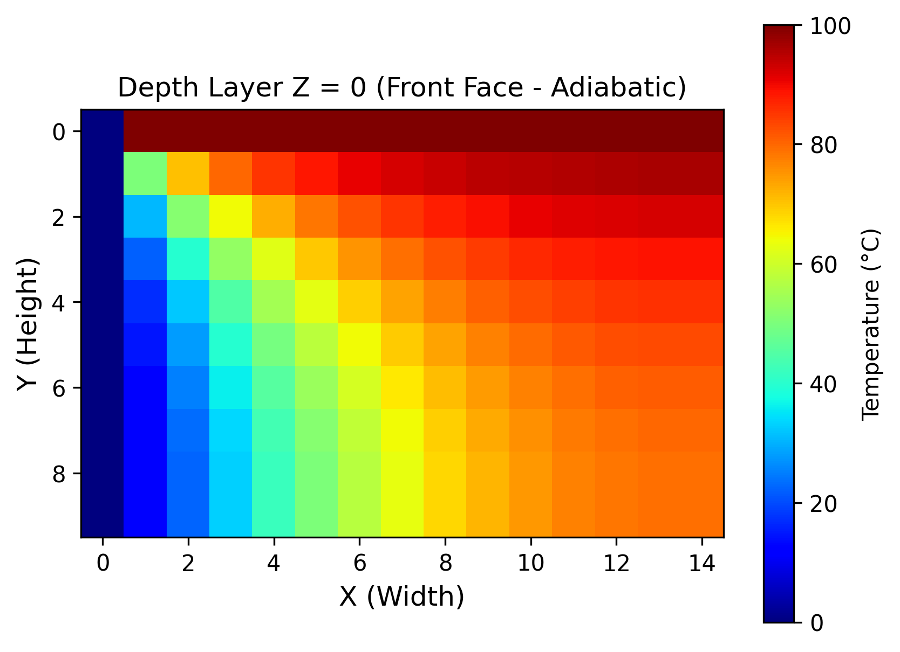
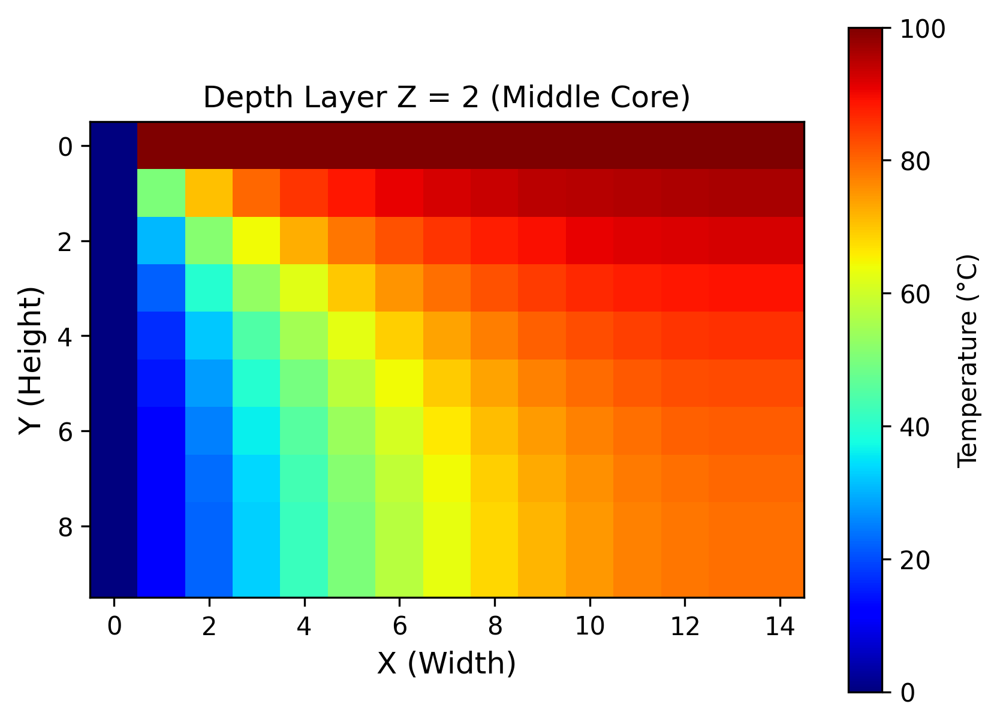

# Computational CAE Solvers in Python (FEA & FDM)

A collection of foundational Computer-Aided Engineering (CAE) solvers developed from scratch in Python using NumPy and Matplotlib, covering numerical discretization, direct stiffness assembly, boundary conditions, and post-processing.

---

## 1. 3D Steady-State Heat Conduction Solver (FDM)

### Overview
Simulates 3D thermal conduction across a solid cuboid discretized into an `(nz, ny, nx)` grid using the **Finite Difference Method (FDM)**.

* **Governing Equation:** 3D Laplace equation solved via a 6-neighbor central difference stencil:
  $$\nabla^2 T = \frac{\partial^2 T}{\partial x^2} + \frac{\partial^2 T}{\partial y^2} + \frac{\partial^2 T}{\partial z^2} = 0$$
* **Boundary Conditions:**
  * **Dirichlet:** Top surface fixed at $100^\circ\text{C}$ ($y=0$), Left wall fixed at $0^\circ\text{C}$ ($x=0$).
  * **Neumann (Adiabatic):** Remaining four faces insulated ($\frac{\partial T}{\partial n} = 0$).
* **Post-Processing:** Extracted internal 2D planar slices across $Z$-depth layers to evaluate thermal diffusion into the core.

### Visual Results (Internal Slices)
| Front Face ($Z=0$) | Middle Core ($Z=2$) | Back Face ($Z=4$) |
| :---: | :---: | :---: |
|  |  |  |

---

## 2. 3D Space Truss Structural Solver (Direct Stiffness FEA)

### Overview
Calculates 3D nodal displacements for an asymmetric 3-bar steel tripod frame under static downward load using the **Direct Stiffness Method**.

* **Parameters:**
  * Material: Structural Steel ($E = 210\text{ GPa}$, $A = 0.0005\text{ m}^2$)
  * Geometry: 3 pinned ground nodes at $Y = 0$, 1 peak node at $Y = 2\text{ m}$
  * Applied Force: $\mathbf{F} = [0, -10000, 0]^\top\text{ N}$ (10 kN downward at the peak)
* **Formulation:** Evaluates 3D direction cosines ($l, m, n$), generates element stiffness matrices ($k_e = \frac{AE}{L}\mathbf{T}$), and performs global stiffness assembly ($[K_{peak}]$).
* **Linear Solver:** Evaluates $[K]\{u\} = \{F\}$ using `numpy.linalg.solve()`.

### Key Findings
* **Vertical Deflection ($Y$):** $\approx -0.093\text{ mm}$
* **Geometric Asymmetry:** Due to the rear foot offset ($Z = 1.5\text{ m}$ vs. peak at $Z = 0.5\text{ m}$), a non-zero off-diagonal cross-coupling term ($-1.326 \times 10^6\text{ N/m}$) causes an out-of-plane shift along the $Z$-axis under pure vertical loading.

---

## Tech Stack
* **Language:** Python
* **Libraries:** NumPy, Matplotlib
* **Environment:** VS Code, Jupyter Notebooks (Miniconda)